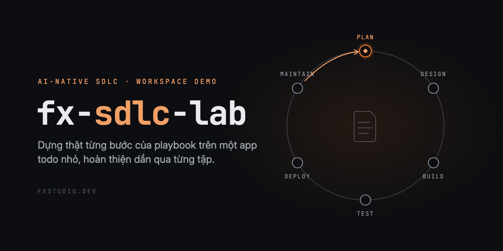

# fx-sdlc-lab



**AI-Native SDLC · workspace demo của Fx Studio.**

Workspace đi kèm loạt video **AI-Native SDLC** của [Fx Studio](https://fxstudio.dev/): đọc *The AI-native SDLC playbook*
(Anthropic, 21/8/2026) bằng lời của mình, rồi **dựng thật** từng bước trên một sản phẩm nhỏ để xem câu nào đứng được, câu nào cần sửa.

Sản phẩm là một app todo-list ở [`app/`](app/): HTML/JS thuần, dữ liệu nằm trong `localStorage` của trình duyệt, không server, không tài
khoản. Mỗi tập của loạt thêm vào repo những thứ một bước SDLC cần, nên repo lớn dần theo loạt.

**Tác giả & bản quyền:** thuộc về [Fx Studio](https://fxstudio.dev/). Dùng theo giấy phép đính kèm.

## Đã có

| Tập | Bước | Thêm gì | Bằng chứng | Blog |
|---|---|---|---|---|
| SDLC-0 | Tổng quan: code nhanh rồi, sao team vẫn chậm? | `docs/`: ghi chép đọc playbook theo sáu bước, kèm chỗ còn hở và cách vá ban đầu | không có demo (tập bản đồ) | [Code nhanh rồi, sao team vẫn chậm?](https://fxstudio.dev/ai-native-sdlc-code-nhanh-team-van-cham/) |
| SDLC-1 | Plan: ý tưởng thành `intent.md` | skill `write-intent`, subagent `intent-reviewer`, hook `no-self-approve`, thư mục `intent/` | [demo/sdlc-1/](demo/sdlc-1/README.md) | [Ý tưởng thành intent.md](https://fxstudio.dev/ai-native-sdlc-plan-y-tuong-thanh-intent/) |
| SDLC-2 | Design: `intent.md` thành `spec.md` | skill `write-spec`, ba skill `policy-*` có phiên bản, subagent `spec-reviewer`, spec job (git `post-commit`), hook `no-self-approve` bản 2, thư mục `spec/` | [demo/sdlc-2/](demo/sdlc-2/README.md) | [intent.md thành spec.md](https://fxstudio.dev/ai-native-sdlc-design-intent-thanh-spec/) |
| SDLC-3 | Build: plan trước, code sau | `CLAUDE.md` mục Build (bảng phân hạng, plan bốn mục, Things Claude gets wrong), thư mục `plan/`, ba hook build (`protect-paths`, `no-secrets`, `check-js`), subagent `verifier`, git `pre-commit` đòi plan đi cùng code, bộ thử kích hoạt skill; **tính năng sao lưu / nhập lại** trong `app/` và bộ test đầu tiên (`tests/`, 42 test) | [demo/sdlc-3/](demo/sdlc-3/README.md) | [Build: plan trước, code sau](https://fxstudio.dev/ai-native-sdlc-build-plan-truoc-code-sau/) |
| SDLC-4 | Test: agent tự kiểm, cấu hình cũng phải test | `CLAUDE.md` mục Verification, `scripts/check.sh` (một lệnh kiểm), hook `protect-tests`, `scripts/flaky.sh`, subagent `test-writer`, **bộ eval** `evals/` (9 task từ lịch sử repo, test ẩn, chấm bằng máy, đo A/B cấu hình), workflow `evals.yml` (chưa bật), `scripts/shot.py` cho vòng kiểm bằng hình; sửa T-013, T-014 (bug gài có chủ ý), 44 test | [demo/sdlc-4/](demo/sdlc-4/README.md) | [Test: agent tự kiểm, cấu hình cũng phải test](https://fxstudio.dev/ai-native-sdlc-test-agent-tu-kiem/) |
| SDLC-5 | Deploy: review hai chiều, agent dừng trước cổng production | `REVIEW.md`, pull request cục bộ (`scripts/pr.py`: cỡ + nhãn rủi ro do script tính), `scripts/review.py` (review chỉ đọc, bảng đếm theo mức), `/watch-pr`, `scripts/triage.py`, deploy ba môi trường cục bộ + MCP server `deploy` (production chỉ `prepare_release`), `rollback.py` + `rollback-drill.py`, hook `release-gate` (duyệt gắn với một bản) cạnh hook mẫu `production-gate.sh` để so; PR 1, 3 merge; spec + plan hạn chót accepted, PR 5–7 chờ review | [demo/sdlc-5/](demo/sdlc-5/README.md) | [Deploy: agent dừng trước cổng production](https://fxstudio.dev/ai-native-sdlc-deploy-truoc-cong-production/) |
| SDLC-6 | Maintain: khép vòng, sự cố thành intent.md mới | watch job (`scripts/collect.py` · `detect.py` không model, có unit test · `watch.py`), `ops/bands.yaml` ba mức, skill `diagnose`, `ci_log.py`, `intent/auto/` + `ops/triage.md` + `triage-stats.py`, `ops/lessons.md`, scan tự dựng `scripts/scan.py`, eval E10, workflow `watch.yml`/`scan.yml` (chỉ chạy tay); chỉ số, người dùng và sự cố là giả lập; PR 8–12 merge | [demo/sdlc-6/](demo/sdlc-6/README.md) | (điền khi đăng) |

Các bài của loạt trên blog: https://fxstudio.dev/tag/ai-native-sdlc/


## Mang về repo của bạn (bước Plan)

Cần Claude Code và `python3` (cho hook).

1. Chép `.claude/skills/write-intent/` vào `.claude/skills/` của repo bạn. Sửa `template.md` cho hợp với team (giữ nguyên các heading thì
   checklist vẫn chạy).
2. Chép `.claude/agents/intent-reviewer.md` vào `.claude/agents/` nếu muốn có người đọc thứ hai cho product owner.
3. Muốn chặn agent tự duyệt: chép `.claude/hooks/no-self-approve.py` và khối `hooks` trong `.claude/settings.json`. Hook chặn agent
   `git merge` / `rebase` / `push` và commit trên `main`. Nó chỉ chặn lệnh agent chạy qua Bash; ở team, thêm branch protection phía server.
4. Tạo thư mục `intent/` rồi gõ trong Claude Code:

```
/write-intent Dạo này khách cứ email than là mất hết việc trong app, nhất là sau khi đổi điện thoại.
```

Claude kiểm trùng với các intent đã có, đọc code trước, hỏi tối đa bốn câu mỗi lượt, rồi viết `intent/<ngày>-<slug>.md` ở trạng thái
`draft`, mỗi dòng bằng chứng ghi nguồn. Thứ chưa biết thành câu hỏi mở, không bị điền bừa. Ở SDLC-1, intent nằm trên một nhánh và **product owner duyệt
bằng cách merge**. Từ SDLC-2, repo này để mọi thứ ở `main`: **product owner duyệt bằng cách tự đổi `Status: draft` thành
`Status: accepted` rồi commit**. Hook bản 2 chặn agent làm việc đó. Team của bạn quen pull request thì giữ cách merge, cả hai đều được.

## Mang về repo của bạn (bước Design)

Cần Claude Code, `python3` (cho hook) và `bash` (cho spec job).

1. Viết policy của team thành skill theo khuôn `.claude/skills/policy-*/SKILL.md`: mỗi luật một mã, có `version` và `owner`. Ba policy
   trong repo là **mẫu**, đừng dùng nguyên. Bắt đầu từ policy hay bị nhắc nhất trong các lần review gần đây.
2. Chép `.claude/skills/write-spec/` và `.claude/agents/spec-reviewer.md`. Sửa `risk-list.md` cho hợp với team: demo cho thấy danh sách
   mẫu gắn nhãn rủi ro cao cho mọi spec của một app nhỏ.
3. Có intent đã `Status: accepted`, gõ trong Claude Code:

```
/write-spec intent/2026-10-19-khach-khong-mat-viec.md
```

Claude đọc intent, code và mọi policy, viết `spec/<cùng tên>.md` ở trạng thái `draft`: dòng đầu ghi phiên bản từng policy, mục
**Assumptions** gồm các câu có/không có tên người trả lời, chỗ hai policy mâu thuẫn thành một mục Concerns có phương án nhưng không chọn.
4. Muốn chấp nhận intent là tự có spec nháp: chép `scripts/` rồi chạy `scripts/install-hooks.sh` (git `post-commit`, chỉ ở máy bạn).
5. Muốn chặn agent tự duyệt: hook `no-self-approve.py` bản 2 chặn cả việc ghi `Status: accepted` vào `intent/`, `spec/`.

## Mang về repo của bạn (bước Build)

Cần Claude Code, `python3` (cho hook), Node (cho `node --test` của app mẫu; repo của bạn dùng test runner của nó).

1. Thêm vào `CLAUDE.md` của bạn ba thứ, theo mục **Build** của `CLAUDE.md` repo này: lệnh chạy app / test / lint; **bảng phân hạng
   thay đổi** (hạng nào cần plan mode, hạng nào cần `plan/<tên>.md`, hạng nào cần tech lead duyệt trước); mục **Things Claude gets
   wrong**, chỉ thêm một dòng khi **cùng một lỗi** đã xảy ra hai lần. Có thể bắt đầu bằng `/init`, nhưng soát lại: demo thấy `/init`
   viết phần kiến trúc tốt, bỏ luật của người, và tự bịa lỗi chưa xảy ra.
2. Bắt đầu mỗi thay đổi bằng plan mode (`Shift+Tab` hai lần, hoặc `claude --permission-mode plan`). Trước khi duyệt, hỏi plan ít nhất
   câu này: *"Test nào fail nếu bước rủi ro nhất làm sai?"*. Đưa plan cho người **không xem hội thoại** đọc; người đó làm theo được thì
   lưu vào `plan/<tên>.md` ở `Status: draft`, rồi một người đổi `accepted` và commit.
3. Chép `.claude/hooks/protect-paths.py`, `no-secrets.py`, `check-js.py` (sửa danh sách đường dẫn và lệnh kiểm cho hợp repo bạn) và khối
   `hooks` trong `.claude/settings.json`. Hook ghi thời gian vào `.hook-timing.log` (đã ignore) để bạn biết nó có làm chậm không.
4. Chép `.claude/agents/verifier.md`. Nó chỉ có Bash + Read nên không tự dựng được script giả lập; nếu repo bạn cần, cho nó thêm Write
   vào một thư mục tạm, hoặc viết sẵn test để nó chạy.
5. Muốn commit code phải kèm plan: chép `scripts/pre-commit` rồi chạy `scripts/install-hooks.sh`. Thay đổi nhỏ thì
   `PLAN_SKIP="<lý do>" git commit …`.
6. Viết `triggers.md` cho từng skill policy rồi chạy `scripts/skill-triggers.sh <skill>`. Demo ra 0/5 cho `policy-security`: đừng tin
   skill tự kích hoạt ở bước Build, hãy gọi tên nó trong prompt hoặc trong plan.
7. Chạy song song: trước khi mở hai worktree, hỏi một phiên plan mode *"hai việc này đụng chung file nào?"*. Mỗi worktree một nhánh tạm,
   người commit và gộp về `main`, rồi xoá nhánh.

## Mang về repo của bạn (bước Test)

Cần Claude Code, `python3`, Node (app mẫu). Eval tốn tiền mỗi lần chạy (demo: ~2,9 USD cho 9 task).

1. Gói việc kiểm thành **một lệnh** (`bash scripts/check.sh` ở đây) và chép mục **Verification** của `CLAUDE.md`: output mẫu khi ổn,
   "chạy trước khi báo xong và dán output", "check fail thì sửa code, không sửa test". Giữ đúng giới hạn của câu cuối: nó nói về lúc
   check fail, **không** cấm cập nhật test khi chính yêu cầu đổi. Bản đầu của demo viết rộng hơn và làm tụt eval (R6).
2. Sửa bug: test tái hiện trước, người commit, rồi mở phiên `TASK_KIND=fix`. Chép `.claude/hooks/protect-tests.py` + khối của nó trong
   `settings.json`. Demo: agent không tự làm yếu test, nhưng bị **bảo** nới test thì nới; hook là thứ chặn (R2c).
3. Chạy `bash scripts/flaky.sh 10` trước khi bật vòng tự kiểm. Test nào đổi kết quả thì ghi vào danh sách cách ly trong `CLAUDE.md`.
4. Bộ eval: chép `evals/`. Mỗi task là một việc thật đã có kết quả được chấp nhận: `base` (commit bắt đầu), `prompt`, `check` (xem đầu
   `evals/check.py`), test ẩn đặt tên `*.eval.js` để `node --test` không tự chạy. Viết xong, **thử test ẩn trên bản lỗi (phải fail), bản
   đã sửa, và ít nhất một lời giải đúng khác (phải pass)**: demo có ba chỗ chấm sai do người viết eval.
5. Đo một thay đổi cấu hình: `python3 evals/run.py --label <tên> --repeat 2 --config-from <thư-mục có CLAUDE.md và .claude mới>`. Đọc
   **từng task** trong `evals/results/history.jsonl`, không chỉ tổng: ở demo tổng đứng yên 12–13/16 trong khi từng task lên xuống 2/2 ↔ 0/2.
6. Sự cố thành eval: đưa ticket + commit sửa cho Claude, bảo viết theo khuôn `evals/tasks/*.json`; người kiểm fail/pass trên hai commit.
7. CI: `.github/workflows/evals.yml` theo khuôn của playbook (PR đụng `CLAUDE.md` / `.claude/` / `evals/` + mỗi tuần). **Ở repo này
   chỉ chạy tay**: task bắt đầu từ commit cũ trong lịch sử, mà GitHub chỉ nhận một commit mỗi tập nên không có các commit đó.
   Repo của bạn có đủ lịch sử thì bật lại hai trigger, thêm `ANTHROPIC_API_KEY` vào GitHub Secrets, chạy thử ở máy trước.

## Mang về repo của bạn (bước Deploy)

Cần Claude Code, `python3`, `git`. Mọi thứ chạy ở máy; không cần GitHub.

1. Chép `REVIEW.md` và sửa ba lượt theo policy của team. Demo cho thấy: lỗi lệch policy bị bắt cả khi không có file (nếu policy đã là skill);
   thứ file thêm vào là **mức Important/Nit và bảng đếm** để một cổng merge đọc được.
2. Review một nhánh: `python3 scripts/pr.py new <slug>` rồi `python3 scripts/review.py <n>`. Ra `review/<n>/<lượt>/findings.json`,
   `tally.json`, `comment.md`. Muốn chạy trên GitHub thì dùng claude-code-action với cùng `REVIEW.md`.
3. Cỡ và rủi ro do script tính, không do agent chọn: sửa bảng `RISK` trong `scripts/pr.py` theo đường dẫn của repo bạn. Cảnh báo > 400 dòng.
   ⚠ Nhãn theo đường dẫn lách được (tách file ra PR khác) và nhìn sót (đổi dạng dữ liệu mà không đụng file "nguy hiểm").
4. Cổng production: **đừng dựa vào hook so chữ trong lệnh.** Demo R8: hook mẫu của playbook bị vượt bằng một script trung gian, và cả hook của
   repo này cũng cho qua đường đó. Lớp giữ chắc là **phạm vi công cụ**: chép `tools/deploy-mcp/` (production chỉ `prepare_release`) và ở môi
   trường thật, agent không cầm quyền ghi production. Hook `release-gate.py` là lưới: duyệt gắn với một bản (`release/approvals/<sha>.md` người
   commit trên `main`).
5. Tập rollback: `python3 scripts/rollback-drill.py staging 10`. Rollback chỉ gỡ được bản do chính công cụ deploy đưa lên.

## Mang về repo của bạn (bước Maintain)

Cần Claude Code, `python3` (có PyYAML), `node`. Mọi thứ chạy ở máy; workflow `watch.yml`/`scan.yml` là khuôn, chỉ chạy tay.

1. Bắt đầu bằng **tỉ lệ CI fail**, chưa đụng production. Thu mỗi ngày (`scripts/collect.py ci`), phát hiện bằng `scripts/detect.py`
   (thống kê, không model, có unit test). Demo: test tất định cho sd = 0, tức **chưa có mức nền**: dùng ngưỡng cố định trong `bands.yaml`.
2. Chép `ops/bands.yaml` và sửa: mức 1 log, mức 2 chẩn đoán chỉ đọc, mức 3 chỉ hai đường (PR vào cổng review, hoặc runbook duyệt trước).
   Tuần đầu **chưa bật mức 3**. Đặt sàn "đáng gọi người dậy" (`min_value`) và ghi mô hình nhiễu: demo báo nhầm ở mức 3 hai lần trong 60
   ngày-môi trường trước khi có sàn.
3. `scripts/watch.py tick <metric>` gọi `claude -p` với đúng danh sách công cụ của mức đó; **script ghi intent**, agent mức 2 không có công cụ
   ghi. ⚠ Danh sách theo tiền tố lệnh chưa phải chỉ đọc: `git diff/log/show --output=<file>` ghi được file (scan R6).
4. Phân loại có lý do: `ops/triage.md` + `python3 scripts/triage-stats.py`. Nhiều `false-alarm` → nới ngưỡng; nhiều `wrong-diagnosis` →
   thêm ngữ cảnh cho skill `diagnose`. Demo: người trực tin một chẩn đoán sai nghe hợp lý và xếp lịch điều tra một nguyên nhân không có thật.
5. Mỗi sự cố đã sửa: năm dòng trong `ops/lessons.md` và một eval (thử test ẩn trên bản lỗi, bản đúng, **và một lời giải đúng khác**).
6. Chưa có Claude Security: `python3 scripts/scan.py --full --label baseline` một lần, rồi `--since <ref>` hằng tuần. Không xác thực, nên
   đọc từng phát hiện. Lần đầu demo tìm ra 4 chỗ trong chính code vừa viết.
7. Chữ trong log, test output, ticket là dữ liệu: ghi vào skill chẩn đoán. Demo R7: 6/6 lượt không làm theo câu lệnh cài trong log; có luật
   thì agent **báo lại** cho người trực (3/3), không luật thì có lượt im lặng.

## Bố cục

```
app/                    sản phẩm: app todo
intent/                 intent.md, mọi thứ ở main; Status: draft hoặc accepted (người đổi, người commit)
spec/                   spec.md của bước Design, cùng tên với intent
plan/                   plan.md của bước Build, cùng tên; người đổi Status: accepted
tests/                  node --test, không package
evals/                  bộ eval: tasks/*.json, hidden/*.eval.js, check.py (chấm), run.py (chạy, đo A/B cấu hình), results/
ops/                    Maintain: bands.yaml, metrics/ (giả lập), ci/, watch.jsonl, triage.md, lessons.md, scan/, tests/
scripts/                spec job (on-intent-accepted.sh), pre-commit, install-hooks.sh, skill-triggers.sh, check.sh, flaky.sh, shot.py
tickets/                ticket mẫu
.claude/
  skills/write-intent/  SKILL.md · template.md · checklist.md
  skills/write-spec/    SKILL.md · template.md · risk-list.md · checklist.md
  skills/policy-*/      policy mẫu của team (privacy, security, ux), có phiên bản
  agents/               intent-reviewer.md · spec-reviewer.md · verifier.md (chỉ đọc, chỉ báo) · test-writer.md (chỉ từ spec)
  hooks/                no-self-approve.py · protect-paths.py · no-secrets.py · check-js.py · protect-tests.py
  settings.json         gắn hook
demo/sdlc-<n>/          bằng chứng của từng tập: nhân vật giả lập, script chạy lại, transcript nguyên văn, kết luận
docs/                   ghi chép của tác giả về playbook, theo từng bước
```

Thành phần cho agent (`.claude/`, template) viết tiếng Anh. Ghi chép và kết luận viết tiếng Việt.

## Lưu ý

- Mọi người, ticket và con số trong `tickets/` và `demo/` là **dữ liệu mẫu**, không phải người dùng thật.
- Mỗi kịch bản demo chạy **một lần**. Đó là ví dụ thật, không phải thống kê.
- Playbook gốc: https://claude.com/resources/articles/the-ai-native-sdlc-playbook. Chỗ nào là nhận xét của tác giả repo, tài liệu ghi rõ.
