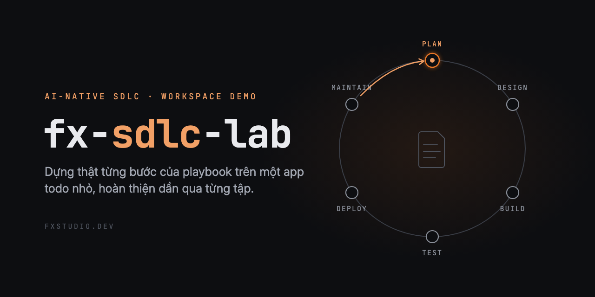

# fx-sdlc-lab



**AI-Native SDLC · workspace demo của Fx Studio.**

Workspace đi kèm loạt video **AI-Native SDLC** của [Fx Studio](https://fxstudio.dev/): đọc *The AI-native SDLC playbook*
(Anthropic, 21/8/2026) bằng lời của mình, rồi **dựng thật** từng bước trên một sản phẩm nhỏ để xem câu nào đứng được, câu nào cần sửa.

Sản phẩm là một app todo-list ở [`app/`](app/): HTML/JS thuần, dữ liệu nằm trong `localStorage` của trình duyệt, không server, không tài
khoản. Mỗi tập của loạt thêm vào repo những thứ một bước SDLC cần, nên repo lớn dần theo loạt.

**Tác giả & bản quyền:** thuộc về [Fx Studio](https://fxstudio.dev/). Dùng theo giấy phép đính kèm.

## Đã có

| Tập | Bước | Thêm gì | Bằng chứng | Blog |
|---|---|---|---|---|
| SDLC-0 | Tổng quan: code nhanh rồi, sao team vẫn chậm? | `docs/`: ghi chép đọc playbook theo sáu bước, kèm chỗ còn hở và cách vá ban đầu | không có demo (tập bản đồ) | [Code nhanh rồi, sao team vẫn chậm?](https://fxstudio.dev/ai-native-sdlc-code-nhanh-team-van-cham/) |
| SDLC-1 | Plan: ý tưởng thành `intent.md` | skill `write-intent`, subagent `intent-reviewer`, hook `no-self-approve`, thư mục `intent/` | [demo/sdlc-1/](demo/sdlc-1/README.md) | [Ý tưởng thành intent.md](https://fxstudio.dev/ai-native-sdlc-plan-y-tuong-thanh-intent/) |

Các bài của loạt trên blog: https://fxstudio.dev/tag/ai-native-sdlc/


## Mang về repo của bạn (bước Plan)

Cần Claude Code và `python3` (cho hook).

1. Chép `.claude/skills/write-intent/` vào `.claude/skills/` của repo bạn. Sửa `template.md` cho hợp với team (giữ nguyên các heading thì
   checklist vẫn chạy).
2. Chép `.claude/agents/intent-reviewer.md` vào `.claude/agents/` nếu muốn có người đọc thứ hai cho product owner.
3. Muốn chặn agent tự duyệt: chép `.claude/hooks/no-self-approve.py` và khối `hooks` trong `.claude/settings.json`. Hook chặn agent
   `git merge` / `rebase` / `push` và commit trên `main`. Nó chỉ chặn lệnh agent chạy qua Bash; ở team, thêm branch protection phía server.
4. Tạo thư mục `intent/` rồi gõ trong Claude Code:

```
/write-intent Dạo này khách cứ email than là mất hết việc trong app, nhất là sau khi đổi điện thoại.
```

Claude kiểm trùng với các intent đã có, đọc code trước, hỏi tối đa bốn câu mỗi lượt, rồi viết `intent/<ngày>-<slug>.md` ở trạng thái
`draft`, mỗi dòng bằng chứng ghi nguồn. Thứ chưa biết thành câu hỏi mở, không bị điền bừa. Commit lên một nhánh; **product owner duyệt
bằng cách merge**.

## Bố cục

```
app/                    sản phẩm: app todo
intent/                 intent.md đã được duyệt (trống: chưa có intent nào được merge; bản nháp của demo ở demo/sdlc-1/drafts/)
tickets/                ticket mẫu
.claude/
  skills/write-intent/  SKILL.md · template.md · checklist.md
  agents/               intent-reviewer.md (chỉ đọc)
  hooks/                no-self-approve.py
  settings.json         gắn hook
demo/sdlc-<n>/          bằng chứng của từng tập: nhân vật giả lập, script chạy lại, transcript nguyên văn, kết luận
docs/                   ghi chép của tác giả về playbook, theo từng bước
```

Thành phần cho agent (`.claude/`, template) viết tiếng Anh. Ghi chép và kết luận viết tiếng Việt.

## Lưu ý

- Mọi người, ticket và con số trong `tickets/` và `demo/` là **dữ liệu mẫu**, không phải người dùng thật.
- Mỗi kịch bản demo chạy **một lần**. Đó là ví dụ thật, không phải thống kê.
- Playbook gốc: https://claude.com/resources/articles/the-ai-native-sdlc-playbook. Chỗ nào là nhận xét của tác giả repo, tài liệu ghi rõ.
